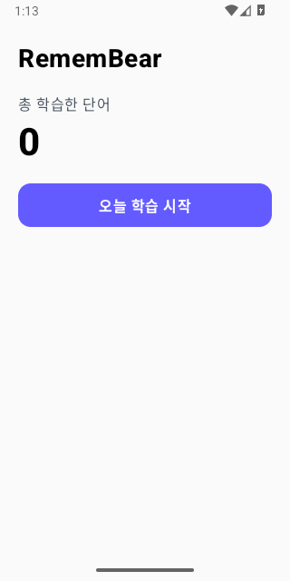
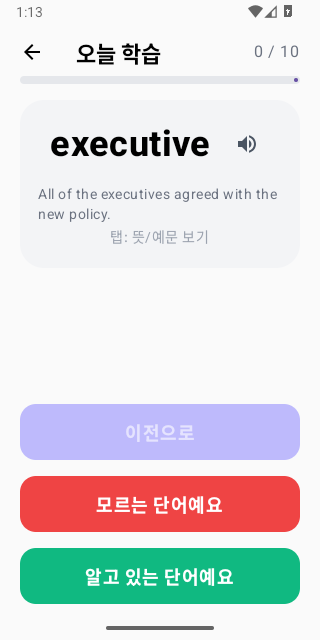
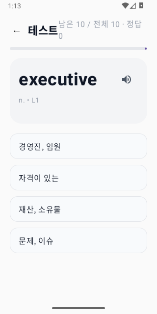

# RememBear 🐻

매일 영어 단어를 익히고 퀴즈로 확인하는 Kotlin Multiplatform 앱입니다. Android와 iOS에서 Compose Multiplatform 화면을 공유합니다.

## 앱 화면

| 홈 | 단어 학습 | 테스트 |
|:---:|:---:|:---:|
|  |  |  |

## 주요 기능

- 기본 학습 묶음인 10개 단어를 순서대로 학습합니다.
- 단어 카드를 탭해 뜻과 예문을 확인하고, 발음 버튼으로 단어를 듣습니다.
- 모르는 단어는 학습 순서의 뒤로 보내 다시 보고, 이전 카드로 돌아갈 수 있습니다.
- 학습을 마치면 객관식 테스트를 진행합니다. 틀린 문제는 다시 출제됩니다.
- 테스트를 모두 맞히면 학습 수와 다음 학습 위치가 기기에 저장됩니다.

현재 저장소에는 학습용 영어 단어 100개가 포함되어 있습니다. 하루 목표 기본값은 10개이며 앱 화면에서 변경하는 기능은 아직 없습니다.

## 기술 구성

- Kotlin Multiplatform, Compose Multiplatform, Material 3
- Android: minSdk 24, compileSdk/targetSdk 36
- iOS: `iosArm64`, `iosSimulatorArm64`
- 학습 상태 저장: Multiplatform Settings
- 단어 데이터: `composeApp/src/commonMain/composeResources/files/words.json`

## Android 빌드 및 실행

Android SDK와 JDK 17 이상을 설치한 뒤 저장소 루트에서 실행합니다.

```bash
# macOS / Linux
./gradlew :composeApp:assembleDebug

# Windows
.\gradlew.bat :composeApp:assembleDebug
```

완성된 APK는 `composeApp/build/outputs/apk/debug/composeApp-debug.apk`에 생성됩니다. Android Studio에서 `composeApp` 실행 구성을 선택하거나, 연결된 기기에 다음 명령으로 설치할 수 있습니다.

```bash
adb install -r composeApp/build/outputs/apk/debug/composeApp-debug.apk
adb shell am start -n com.devlog.remember/.MainActivity
```

## iOS 실행

macOS와 Xcode에서 `iosApp/iosApp.xcodeproj`를 열고 iOS 시뮬레이터 또는 기기를 선택해 실행합니다. 이 저장소의 iOS 빌드는 macOS/Xcode 환경이 필요합니다.

## 프로젝트 구조

```text
composeApp/src/commonMain/   공유 UI, 학습 로직, 단어 데이터
composeApp/src/androidMain/  Android 진입점, TTS, 분석
composeApp/src/iosMain/      iOS 진입점, TTS
iosApp/                     Xcode 앱 프로젝트
docs/screenshots/           Android 에뮬레이터 실행 화면
```
